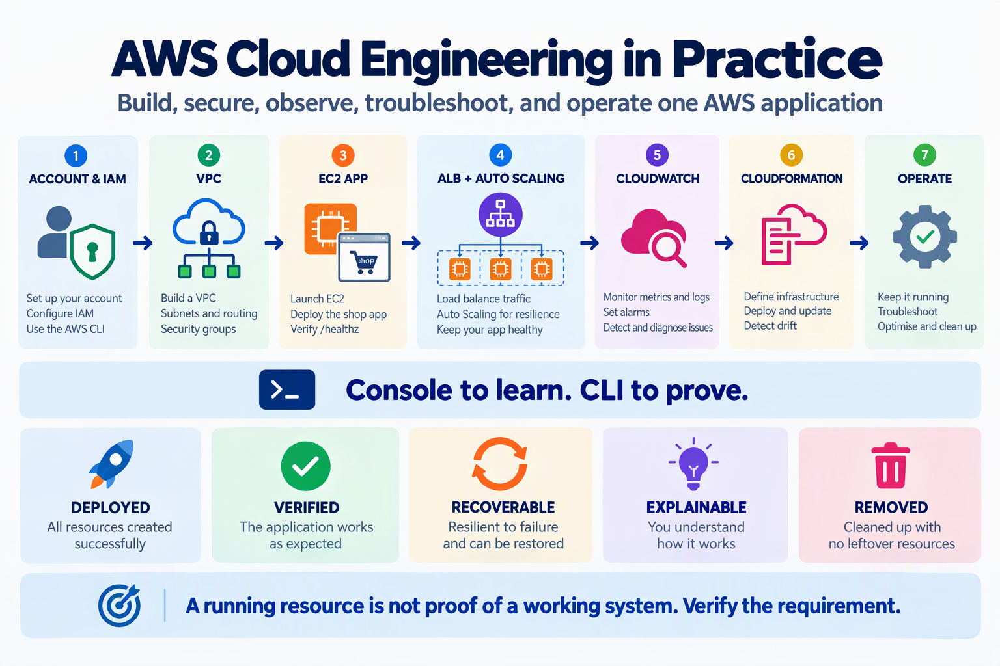

# AWS Cloud Engineering in 10 Days

This is the companion repository for *AWS Cloud Engineering in 10 Days: Build, Secure, Monitor, Troubleshoot, and Operate Your First AWS Environment* by **Victor Ebai**. It provides the Shop application files, CloudFormation examples, day-by-day instructions and validation scripts used by the hands-on exercises.

**The book is fully self-contained.** You can follow the explanations and exercises without cloning this repository. These files offer convenient, testable starting points; they do **not** deploy the entire ten-day environment automatically.

## Get the book on Amazon

<a id="get-the-paperback"></a>

**Paperback:** [Amazon UK](https://www.amazon.co.uk/dp/B0HR7NQM3R) · [Amazon US](https://www.amazon.com/dp/B0HR7NQM3R) · [Amazon India](https://www.amazon.in/dp/B0HR7NQM3R)

**Kindle eBook:** [Amazon UK](https://www.amazon.co.uk/dp/B0HR7DPTP8) · [Amazon US](https://www.amazon.com/dp/B0HR7DPTP8) · [Amazon India](https://www.amazon.in/dp/B0HR7DPTP8)

**Quick navigation:** [Getting started](#start-here--first-use) · [Day-by-day guides](#day-by-day-contents--clickable-guides) · [Reader files](#other-reader-files) · [Safety and cleanup](#safety-cost-and-cleanup)

The learning path develops one AWS Shop application from account identity and networking to EC2, load balancing, monitoring, infrastructure as code and operational recovery.



*Learning overview: build and verify the Shop environment, understand how its parts interact, troubleshoot faults and clean up safely. These seven stages summarise the ten-day learning path; they are not a single automated deployment.*

The practical habit is **Orient → Build → Observe → Verify → Diagnose → Recover → Explain → Clean up**. Use the book for the concepts, Console guidance and engineering decisions; use these files to carry out and check the exercises.

## What you will build and practise

- Confirm account identity, Region, IAM permissions and cost boundaries before changing AWS resources.
- Build VPC networking and deploy an EC2-hosted Shop application with an observable health endpoint.
- Verify load balancing and Auto Scaling behaviour rather than relying only on resource status.
- Collect logs and metrics using CloudWatch, and investigate failures from evidence.
- Work with CloudFormation templates, updates and change sets.
- Troubleshoot, verify recovery and remove project resources in a controlled order.

## Before you begin

**First-time setup:** [Install the required tools](docs/prerequisites.md), then [configure AWS access and execution context](docs/setup.md).

You need Git, `curl`, Python 3, AWS CLI v2 and an authorised AWS learning account. Optional tools, including `cfn-lint`, are explained in the setup guide. On macOS, Linux or AWS CloudShell, verify the current identity before making changes.

The documented Region is **AWS London (`eu-west-2`)**. Using another Region requires reviewing availability, quotas, resource identifiers and day-specific instructions.

**Cost and security:** EC2, ALB, public IPv4, CloudWatch, storage and other AWS resources can incur charges. Use a dedicated learning environment, prefer temporary credentials, restrict network access, and follow the [cleanup guide](docs/cleanup.md) at the end of every exercise.

## Start here — first use

1. Read [prerequisites and installation](docs/prerequisites.md) to install `curl`, Git, Python 3, AWS CLI v2 and optional template linting tools.
2. Download using **Code → Download ZIP** on GitHub or clone:
   ```bash
   git clone https://github.com/vebai/aws-cloud-engineering-in-10-days.git
   cd aws-cloud-engineering-in-10-days
   ```
   If you downloaded the ZIP, extract it and `cd` into the extracted folder instead.
3. Read [execution context, sign-in and setup](docs/setup.md). Confirm the AWS account before making changes.
4. On your Mac, Linux machine or CloudShell, set the chosen Region (examples use London):
   ```bash
   export AWS_REGION=eu-west-2
   aws --version
   aws sts get-caller-identity
   aws configure list
   ```
5. From the **repository root**, run the non-deploying checks:
   ```bash
   ./validation/validate-repo.sh
   python3 -m unittest discover -s tests -v
   ./validation/validate-aws.sh
   ```
   The first two work without AWS credentials; the last makes read-only calls to your selected AWS account.
6. Open the README for your current day. Before creating anything, open [the cleanup plan](docs/cleanup.md) and start your own private resource ledger.
7. At the end of a lab, follow the [cleanup guide](docs/cleanup.md) and **verify** deletion; stopping an instance is not the same as removing charges.

## Day-by-day contents — clickable guides

| Day | Objective | Reader guide |
| --- | --- | --- |
| 1 | Establish account, Region, costs and safe working habits | [Day 1 — Orientation](days/day-01-orientation/README.md) |
| 2 | Identify the AWS principal and use the CLI safely | [Day 2 — IAM and CLI](days/day-02-iam-and-cli/README.md) |
| 3 | Launch and inspect an EC2 instance bootstrapped with Nginx | [Day 3 — EC2](days/day-03-ec2/README.md) |
| 4 | Inspect S3 storage security and data boundaries | [Day 4 — S3](days/day-04-storage/README.md) |
| 5 | Recognise and build controlled VPC networking | [Day 5 — VPC](days/day-05-vpc/README.md) |
| 6 | Prove the Shop application responds on its instance | [Day 6 — Application](days/day-06-application/README.md) |
| 7 | Verify ALB routing and Auto Scaling replacement | [Day 7 — Load balancing](days/day-07-load-balancing/README.md) |
| 8 | Collect application logs and inspect CloudWatch evidence | [Day 8 — Monitoring](days/day-08-monitoring/README.md) |
| 9 | Evolve S3 CloudFormation templates through create, update and change set; optional network examples | [Day 9 — Infrastructure as code](days/day-09-infrastructure-as-code/README.md) |
| 10 | Troubleshoot, verify recovery and remove lab resources | [Day 10 — Operations](days/day-10-operations/README.md) |

## Other reader files

| Resource | Description |
| --- | --- |
| [Prerequisites](docs/prerequisites.md) | macOS, Ubuntu and other Linux installation instructions; `curl`, AWS CLI, Git, Python |
| [Account setup](docs/setup.md) | Where to run commands; authentication; identity/Region checks |
| [Security](docs/security.md) | Least privilege, SSM and restricted network boundaries |
| [Troubleshooting](docs/troubleshooting.md) | Diagnostic workflow and common errors |
| [Full cleanup](docs/cleanup.md) | Dependency-aware, explicit cleanup and post-cleanup checks |
| [Shop application](assets/shop/) | Minimal HTML and Nginx example |
| [Validation scripts](validation/) | Offline checks, read-only AWS preflight and inventory |
| [Validation scope](VALIDATION.md) | What automated checks establish and what they do not |

## Safety, cost and cleanup

AWS resources can incur charges, including running EC2 instances, load balancers, NAT gateways, public IPv4 addresses, EBS volumes, CloudWatch, storage and data transfer. **Never run an AWS create or delete command without reviewing your selected account, Region, resource IDs and dependencies first.** The scripts requiring AWS creation have explicit opt-in, but CloudFormation `deploy` and commands shown in guides are real changes.

- Default examples use `eu-west-2`; the Region is a **choice**, not an automatic restriction on other Regions.
- Use temporary credentials and prefer Session Manager to opening SSH to the internet.
- Never commit account secrets, access keys, private keys, real customer data or your personal AWS resource ledger.
- This repo has **no automated destructive cleanup**. See [docs/cleanup.md](docs/cleanup.md).

**Engineering habit:** ORIENT → INSPECT → ACT → VERIFY → DIAGNOSE → RECOVER → CLEAN UP.

Licensed under the [MIT Licence](LICENSE).

**Day 9 template progression:** [S3 baseline](days/day-09-infrastructure-as-code/templates/01-baseline.yml) · [parameterised S3](days/day-09-infrastructure-as-code/templates/02-parameterised.yml) · [versioning change-set proposal](days/day-09-infrastructure-as-code/templates/03-suspend-versioning.yml).

## Continue learning

After completing the Shop deployment and operations exercises, [AWS Incident Troubleshooting](https://www.amazon.co.uk/dp/B0HRCL1B9J) offers separate, controlled AWS failure scenarios using related Shop concepts. **The incident labs deploy their own resources:** do not reuse or disrupt the environment from this repository.

The [book on Amazon UK](https://www.amazon.co.uk/dp/B0HR7DPTP8) provides the complete explanations, architectural decisions and verification method.

The reusable code is covered by the [MIT Licence](LICENSE); the book's text and the overview illustration remain © 2026 Victor Ebai.
